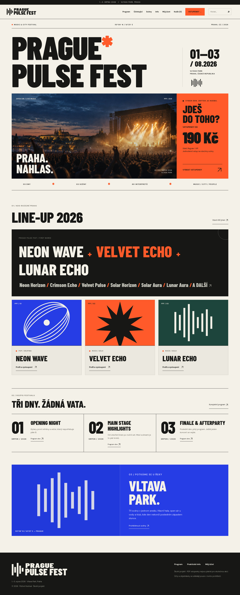

# Prague Pulse Fest

Školní festivalový web: **HTML, CSS a JavaScript bez serveru, instalace a buildu**.

## Spuštění

1. Stáhněte repozitář přes **Code → Download ZIP** a celý archiv rozbalte.
2. Otevřete `web/index.html` v aktuálním prohlížeči.
3. Při otevření z disku navigace používá stejný soubor `index.html` s parametrem `page`, aby košík a účet zůstaly ve stejném úložišti.

Složka `web/` je samostatná a lze ji sdílet celou. Žádná část nevyžaduje Node.js, Python, npm, backend ani databázi. Všechny skripty, obrázky, fonty a PDF knihovny jsou přibalené lokálně, bez CDN a API. Připojení k internetu není pro samotný web potřeba.

## Náhled



[Náhled PDF vstupenky](preview/vstupenka.png) · [Vzorové PDF](preview/vstupenky-ukazka.pdf) · [Mobilní zobrazení](preview/web-mobile.png)

## Funkce

- Nová vizuální identita a originální logo Prague Pulse Fest, výrazná typografie, vlastní festivalová grafika a AI ilustrace koncertu.
- Mobile-first rozložení: Flexbox pro navigaci a ovládání, Grid pro přehledy a mapu.
- 60 interpretů, 60 vystoupení, 3 dny a 3 scény z původních dat.
- Filtry programu, uložený osobní program, kontextové detaily a vyhledávání `contains` napříč daty i informacemi; ignoruje velikost písmen a diakritiku.
- Výběr VIP (590 Kč), Regular (390 Kč) a stání (190 Kč) po jednotlivých dnech, košík, objednávka hosta nebo lokálního účtu.
- Simulace úspěšné i zamítnuté platby.
- **Skutečný soubor PDF vytvořený v prohlížeči**: samostatná stránka pro každou vstupenku, české znaky, barevný design, kategorie, datum, místo, ID objednávky a QR ukázkového identifikátoru. Lze i tisknout.
- Lokální registrace, přihlášení, odhlášení a historie objednávek.

## Rozsah školního projektu

Nejde o skutečný prodej. Účty a objednávky zůstávají v `localStorage` tohoto prohlížeče, přihlášení v `sessionStorage` dané karty. Používejte zkušební údaje a heslo, které jinde nepoužíváte. Heslo se ukládá jako solený PBKDF2-SHA256 hash; lokální účet však není bezpečné serverové ověření identity.

Obsazenost se nesdílí mezi zařízeními, peníze se neodečítají a **e-mail se automaticky neodesílá**. PDF je výslovně označené jako školní ukázka a není platnou vstupenkou na skutečnou akci. Server ani SMTP nejsou součástí odevzdání podle poslední volby uživatele a požadavků předmětu.

## Volitelné kontroly pro vývojáře

Pro ruční používání nejsou tyto nástroje potřeba. Ve spravovaném testovacím Chromium je `file://` blokované systémovou politikou; automatizované testy proto používají obyčejný statický server:

```sh
cd /workspace/webdesign
python -m http.server 8000 --bind 127.0.0.1
```

V dalším terminálu:

```sh
python validate_project.py
node --check web/js/app.js
node --check web/js/design.js
node --check web/js/ticket-pdf.js
python tests/browser_smoke.py
```

Datový validátor používá `lxml`, `PyYAML` a `jsonschema`. Browser test používá Python Playwright, systémový Chromium a PyMuPDF pro kontrolu PDF. Tyto vývojové nástroje se neinstalují kvůli spuštění webu.

`tools/generate_data.py` je volitelná pomůcka pro obnovu hotového `web/js/data.js` po změně zdrojových dat. Není součástí startu ani povinný build. Původní soubory `API/` jsou datové a transformační podklady, nikoli běžící služba. Stránka API ověření byla odstraněna.

Podrobnosti: `documentation.md`, aktuální výsledky: `validation_report.md`, původ a licence grafiky: `web/images/ASSETS.md`, licence PDF knihoven a fontů: `web/vendor/`.
