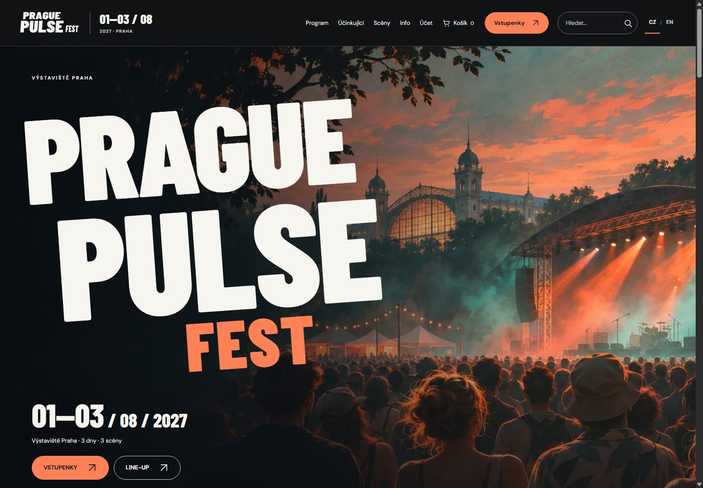

# Prague Pulse Fest

**Najdi koncert. Sestav si vlastní program. Naplánuj návštěvu.**

Responzivní, dvojjazyčný web fiktivního hudebního festivalu **1.–3. srpna 2027 na Výstavišti Praha**. Jeden XML datový základ propojuje 60 účinkujících, 60 koncertů a tři scény.

[Dokumentace](documentation.md) · [Specifikace](project-specification.md) · [Výsledky ověření](validation_report.md)



## Spuštění za půl minuty

1. [Stáhněte projekt jako ZIP](https://github.com/Ladrys/webdesign/archive/refs/heads/main.zip).
2. Rozbalte celý obsah.
3. Otevřete **`web/index.html`** v aktuálním prohlížeči.

**Bez instalace, Node.js, package manageru, buildu a backendu.** JavaScript a místní úložiště prohlížeče musí být povolené. Přibalená data, písma, ilustrace i export PDF fungují offline; externí mapy potřebují souhlas a internet.

## Co lze vyzkoušet

- **Program:** kombinace dne, scény, žánru, textu a vlastního seznamu; upozornění na překryvy koncertů.
- **Účinkující:** všech 60 jmen, filtry a samostatné profily s přímou adresou.
- **Hledání:** skutečné výsledky napříč programem, interprety, scénami a informacemi, nezávislé na diakritice.
- **Vstupenky:** jedna či všechny scény, jeden až tři dny, sedadla nebo stání a průběžná cena.
- **Objednávka:** host i lokální účet, promo kód, kemp a vlastní PDF s QR identifikátory.
- **Areál:** vlastní přibližovací SVG plánek, dostupnost podle dne, doprava a FAQ.
- **CZ / EN:** obsah, ovládání, datum i měna v obou jazycích.

Rychlý scénář: vyhledejte **DARK**, otevřete **DARKZY** a pokračujte na jeho vstup. Den a scéna odpovídají koncertu. Další ověřitelný scénář najdete v [progress-04.md](progress-04.md).

## Technologie a data

Vanilla HTML, CSS a JavaScript, DOM, SVG, Web Crypto a Web Storage. Malé moduly sdílejí výpočty cen a kapacit; žádný framework ani runtime server není součástí webu. `jsPDF` a `QRCode` se načítají lokálně pouze při exportu.

```text
data/festival.xml → odvozené JSON exporty + web/js/data.js → rozhraní
```

XML je zdroj pravdy; exporty se ručně neupravují. [Dokumentace](documentation.md) vysvětluje datové vazby, všechny moduly, úložiště, kapacity, PDF, překlady, UX a SEO/AEO.

## Orientace v repozitáři

| Cesta | Obsah |
| --- | --- |
| `web/` | Kompletní samostatně spustitelný web |
| `data.xml`, `festival.xsd`, `data/` | Odevzdaná data, schéma a odvozené JSON |
| `prototype/` | Interaktivní návrh ze cvičení 3 |
| `project-specification.md` | Cíle, uživatelé, architektura a scénáře |
| `progress-03.md`, `progress-04.md` | Aktuální zprávy pro cvičení 4 a 5 |
| `review/` | Technické výsledky, šablona review a čekající přijatý posudek |
| `docs/`, `preview/` | Podklady, školní logo a aktuální obrazové ukázky |
| `tests/`, `tools/` | Volitelné ověřování a údržba; pro spuštění nejsou potřeba |

## Ověření a vývoj

Nové ověření zahrnuje 14 stránek v obou jazycích, pět šířek od 320 do 1440 px a skutečné průchody programem, hledáním, nákupem, PDF, kapacitami a účtem. Přímé otevření přes `file://` bylo ověřeno v Chrome. [Výsledky a omezení testování](validation_report.md) rozlišují skutečně provedené kontroly od budoucího externího review.

Pro úpravu dat a opakování kontrol použijte [vývojový návod](docs/DEVELOPMENT.md). Vývojové nástroje nejsou nutné pro návštěvníka ani hodnotitele webu.

## Rozsah školní ukázky

Festival, účast interpretů a nabídka jsou fiktivní. Platba se pouze simuluje, nic se neúčtuje a e-mail se neposílá. Účty, košík, objednávky a obsazenost se ukládají v konkrétním prohlížeči a nesdílejí mezi zařízeními. QR nemá serverovou kontrolu. Nepoužívejte skutečné heslo z jiné služby.

Grafiku vytvořila AI; hudební ilustrace nejsou portréty uvedených interpretů. [Původ obrázků](web/images/ASSETS.md) · [Licence knihoven](web/vendor/README.md). Tento repozitář neurčuje novou licenci cizích knihoven ani práv k názvům interpretů.

**Michal Ladra · Matěj Mlejnek · Jan Martínek**  
Česká zemědělská univerzita v Praze · PEF · Webdesign 2026/2027
