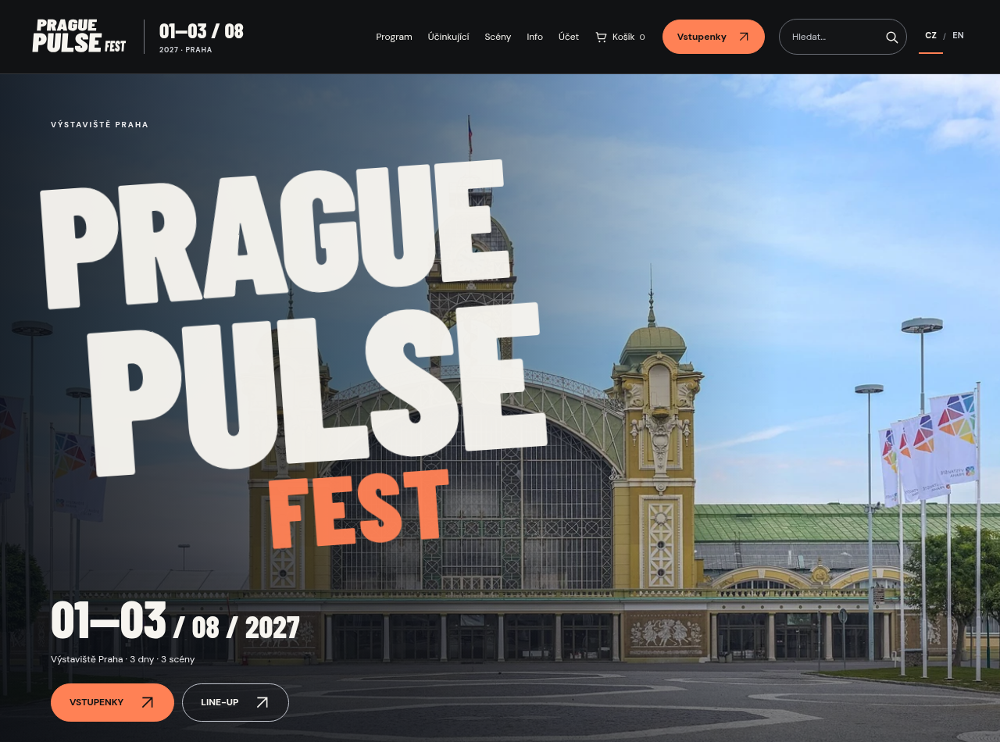

# Prague Pulse Fest

[](https://github.com/Ladrys/webdesign/actions/workflows/validate.yml)


**Najít koncert. Naplánovat návštěvu. Vybrat odpovídající vstup.**

Responzivní web fiktivního festivalu **1.–3. srpna 2027 · Výstaviště Praha**.
Jeden datový základ propojuje 60 interpretů, program tří scén a nákup vstupenek.



## Spuštění

[**Stáhnout projekt**](https://github.com/Ladrys/webdesign/archive/refs/heads/main.zip)
→ rozbalit celý ZIP → otevřít **`web/index.html`** v prohlížeči.

Bez instalace a buildu. Pro web stačí JavaScript a povolené místní úložiště.

## Co web nabízí

- **Program podle návštěvníka:** den, scéna, žánr, hledání a uložené koncerty.
- **Od interpreta ke vstupence:** předvolená scéna a den, vlastní úprava výběru.
- **Přehledný nákup:** 1/2/3 dny, jedna nebo všechny scény, dostupnost a aktuální cena.
- **Účet a PDF:** profil, historie, změna hesla a vstupenky s údaji objednávky.
- **Návštěva areálu:** přibližovací plánek, praktické informace a čeština / angličtina.

## Podklady

| Pro návštěvníka | Pro tým |
| --- | --- |
| [Hotový web](web/) | [Projektová specifikace](project-specification.md) |
| [Cvičení 2 — ZIP k odevzdání](odevzdani/cviceni-02-k-odevzdani.zip) | [Data a struktura projektu](docs/PROJECT-GUIDE.md) |
| [Další cvičení](docs/ODEVZDANI.md) | [Dokumentace](documentation.md) |

```text
web/           hotové stránky, skripty a obrázky
data/         XML, XSD a odvozené JSON exporty
prototype/     interaktivní wireframe
course-source/ zdroje prezentací a průběžných zpráv
odevzdani/     připravené školní výstupy
docs/         průvodce a vývojový návod
review/        vlastní a přijatá hodnocení
tests/ tools/ kontroly a tvorba podkladů
```

Účty, košík a obsazenost se ukládají v daném prohlížeči. Platba je zkušební;
e-mailová služba není připojená. Technické podrobnosti a rozsah ověření uvádí dokumentace.

**Michal Ladra · Matěj Mlejnek · Jan Martínek** · Webdesign 2026/2027

[Licence fotografií](web/images/PHOTO-CREDITS.md) · [Použité knihovny](web/vendor/README.md) · [Vývoj](docs/DEVELOPMENT.md) · [Verze](CHANGELOG.md)
