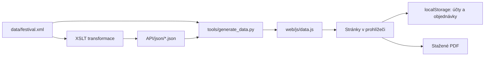

# Jak se v projektu vyznat

Prague Pulse Fest je web prohlížeče: HTML, CSS a JavaScript. Pro otevření hotové verze stačí rozbalit celý ZIP a otevřít [`web/index.html`](../web/index.html). Python slouží autorům ke kontrole dat, testování a tvorbě prezentací; při používání webu se nespouští.

## Tři části repozitáře

| Část | K čemu je | Musí ji mít návštěvník? |
| --- | --- | --- |
| [`web/`](../web/) | Hotový web včetně obrázků, fontů a PDF knihoven. | Ano; stačí tato složka. |
| [`data/`](../data/), [`API/`](../API/), [`tools/`](../tools/), [`tests/`](../tests/) | Zdrojová data a nástroje pro jejich údržbu a ověření. | Ne. |
| [`course-source/`](../course-source/), [`prototype/`](../prototype/), [`review/`](../review/), [`odevzdani/`](../odevzdani/) | Podklady k výuce, wireframe, hodnocení a připravené balíčky pro Moodle. | Ne. |

Základní informace jsou v [`README.md`](../README.md), zadání vlastního festivalu v [`project-specification.md`](../project-specification.md), souhrnná dokumentace v [`documentation.md`](../documentation.md). Její verze k předání jsou `docs/documentation.docx` a `docs/documentation.pdf`. Výsledky konkrétního ověření zachycuje [`validation_report.md`](../validation_report.md). Soubor [`specification.md`](../specification.md) je krátký kompatibilní odkaz na aktuální `project-specification.md`.

## Která stránka dělá co

Každý HTML soubor obsahuje metadata, základ dokumentu a odkazy na společné skripty. Skript `app.js` podle adresy vybere obsah. Detail interpreta, vystoupení nebo článku používá parametr adresy; nemá dalších 60 kopií HTML.

| Soubor v `web/` | Obsah |
| --- | --- |
| `index.html` | Úvod, odpočet, hlavní interpreti, nabídka vstupenek a novinky. |
| `program.html` | Chronologický program, filtry, oblíbená vystoupení a jejich detail. |
| `performers.html` | Seznam interpretů, hledání, žánry a detail s odkazy k poslechu. |
| `venues.html` | Přehled tří scén a odkazy do jejich programu. |
| `info.html` | Doprava, plánek, parkování, kemp, přístupnost a dotazy. |
| `search.html` | Výsledky hledání napříč daty a informačním obsahem. |
| `tickets.html` | Výběr všech scén nebo jedné scény, jednoho/dvou/tří dnů a míst. |
| `cart.html` | Košík, kontakty, promo kód, kemp a dokončení objednávky. |
| `account.html` | Registrace, přihlášení, úprava profilu a historie s PDF. |
| `news.html` | Přehled novinek; `?id=...` zobrazí konkrétní článek. |
| `privacy.html` | Pravidla místního ukládání a externí mapy. |
| `terms.html` | Podmínky objednávky v klientské školní verzi. |
| `credits.html` | Autoři, zdroje a licence použitých fotografií a grafiky. |

Při otevření z disku jsou interní adresy například `index.html?page=program.html`. Funkce `routeUrl()` tím zachovává jeden vstupní soubor, protože prohlížeče mohou oddělovat úložiště různých adres `file://`. Přímé otevření jiného HTML se přesměruje na tento vstup. Na statickém hostingu se používají běžné adresy `program.html` apod.

## JavaScript: rozdělení odpovědností

„Podprogram“ neboli funkce je pojmenovaný postup, který lze zavolat opakovaně. Například `artistDetail(id)` najde interpreta podle ID a otevře jeho detail. Soubory níže obsahují související funkce; HTML je načítá v daném pořadí přes `defer`.

| Soubor v `web/js/` | Odpovědnost a důležité funkce |
| --- | --- |
| `data.js` | Přibalená festivalová data v `window.FESTIVAL_DATA`. Generovaný výstup; žádné síťové načítání XML. |
| `artist-copy.js` | Anglické překlady medailonků a souvisejících textů pro `PulseI18n`. |
| `app.js` | Volba stránky, propojení dat s ovládáním, účet a objednávky. `program()`, `performers()`, `search()`, `tickets()`, `renderCart()` a `account()` sestavují jednotlivé pohledy. |
| `design.js` | Úvodní stránka a vizuální komponenty: `PulseDesign.home()`, `festivalDates()` a `PulseCountdown.getState()`. |
| `site-shell.js` | Společná hlavička, navigace, patička a aktualizace odpočtu: `PulseShell.header()` a `footer()`. |
| `i18n.js` | Výběr CZ/EN, slovník, překlad prvků a zapamatování jazyka: `PulseI18n.t()`, `apply()` a `setLanguage()`. |
| `performer-art.js` | Přiřazení fotografie nebo typografického plakátu k ID interpreta; `PerformerArt.get()` a `style()`. Zpřístupňuje také fotografické kredity `PulsePhotoCredits`. |
| `news.js` | Texty novinek, jejich přehled a článek: `PulseNews.render()`. `searchItems()` předává články vyhledávání. |
| `venue-map.js` | Vlastní orientační SVG plánek a jeho posun či přiblížení: `PulseVenueMap.markup()` a `mount()`. |
| `visitor-pages.js` | Praktické informace, soukromí, podmínky a fotografické kredity: `PulseVisitor.render()`. FAQ poskytuje také vyhledávání. |
| `privacy.js` | Volba nezbytného úložiště / externích map. `PulsePrivacy.mountMap()` načte Google Maps podle souhlasu; `showSettings()` otevře nastavení. |
| `admission.js` | Společná pravidla rozsahu vstupenek: katalog, povolené kategorie, ceny a kapacity scén. Stejná pravidla používá nákup a PDF. |
| `ticket-pdf.js` | Stažení skutečného PDF souboru: `PulseTickets.download()`. `generate()` vytváří stránky vstupenek a případný kempový voucher, `qr()` kreslí identifikátor jako QR. |

V `app.js` jsou důležité ještě tyto společné kroky:

| Funkce | Co kontroluje nebo mění |
| --- | --- |
| `normalize()` / `localizedSearch()` | Připravují data pro hledání části textu bez ohledu na velikost písmen a diakritiku, včetně popisů a překladů. |
| `esc()` | Převede speciální znaky textu před vložením do HTML, aby se například zadané `<script>` nezměnilo na spustitelný kód. |
| `ticketFor()` / `validTicket()` | Určí cenu a dny platnosti; ověří uložený typ, místo a cenu proti katalogu. |
| `occupiedFor()` / `PulseAdmission.remaining()` | Z objednávek současného ročníku získají obsazená sedadla a zbývající kapacitu pro zvolené dny. |
| `promoTotals()` / `includedTax()` | Přepočítají slevu na vstupenky a rozklad již zahrnuté DPH. DPH se nepřičítá podruhé. |
| `campingQuote()` / `campingAvailability()` | Spočítají kemp podle typu a počtu osob a ověří místní zbývající kapacitu. |
| `passwordHash()` / `rememberLogin()` | Vytvoří solený PBKDF2 hash hesla a uloží přihlášení s vypršením po sedmi dnech. |
| `normalizeStoredOrder()` | Ověří uložené doplňky a daňové údaje před zobrazením historie nebo PDF. |

Vzhled všech stránek řídí [`web/css/style.css`](../web/css/style.css): barvy, písmo, flex/grid rozložení, mobilní navigaci, formuláře a stavy tlačítek. JavaScript obsluhuje chování; CSS určuje zobrazení.

## XML, JSON a JSON-LD

Tyto názvy označují různé role dat. JSON v projektu je, pouze není jediným zdrojovým formátem.

| Soubor / formát | Účel |
| --- | --- |
| `data/festival.xml` | Hlavní datová základna: festival, dny, scény, interpreti, program, ceny a kemp. Vztahy používají jednoznačná ID. |
| `data/festival.xsd` | Pravidla struktury XML, datových typů a vazeb. Validátor podle nich hledá chyby. |
| `data.xml`, `festival.xsd` v kořeni | Kopie dat a schématu vhodné pro školní odevzdání. `data.xml` musí odpovídat `data/festival.xml`. |
| `API/transformation/*.xslt` | Sedm XML → JSON transformací pro festival, seznamy a ukázkové detaily. |
| `API/json/*.json` | Sedm výstupů: `festival.json`, `venues.json`, `venue-h1.json`, `performers.json`, `performer-i1.json`, `events.json`, `event-a1.json`. |
| `API/json-schema/*.schema.json` | Sedm schémat kontrolujících odpovídající JSON výstupy. |
| `API/openapi.yaml` | Popis navrženého rozhraní a jeho parametrů. Je to specifikace; projekt žádný API server nespouští. |
| `web/js/data.js` | Stejný datový obsah připravený pro prohlížeč jako JavaScriptová proměnná. Díky tomu hotový web nepotřebuje `fetch()` lokálního XML. |
| JSON-LD v úvodu | `home()` v `web/js/app.js` vloží `<script type="application/ld+json">` s typem `Festival` ze schema.org: název, termín, popis a místo. Je určen vyhledávačům, není databází účtů. |

`tools/generate_data.py` načítá interprety z XML a zbývající připravené údaje z `API/json/`. Sám nepřevádí všechny XML entity do JSON; po změně XML je potřeba nejdříve obnovit příslušné transformované výstupy. Postup je v [návodu pro vývoj](DEVELOPMENT.md).

## Kam se ukládá účet a objednávka

Web nepřepisuje `data.xml` ani žádný soubor `users.json`. Ukládá řetězce JSON do `localStorage` prohlížeče. Data ve stejné instalaci prohlížeče zůstávají po zavření stránky; jiný počítač, profil nebo adresa je automaticky nesdílí. Vymazání dat webu smaže i tato data.

| Klíč místního úložiště | Obsah |
| --- | --- |
| `pulse:users` | Profily: ID, jméno, kontaktní údaje, sůl a hash hesla. Heslo se neukládá jako čitelný text. |
| `pulse:auth` | ID přihlášeného profilu a čas vypršení přihlášení. |
| `pulse:cart:guest` / `pulse:cart:<id>` | Rozpracované vstupenky hosta nebo konkrétního profilu. |
| `pulse:orders` | Dokončené místní objednávky, jejich kontakty, vstupenky, ceny a případný kemp. |
| `pulse:promo:cart:…` / `pulse:camping:cart:…` | Zvolený promo kód a rozpracovaná volba kempu. |
| `pulse:favorites` | ID uložených vystoupení osobního programu. |
| `prf:language` | Volba češtiny nebo angličtiny. |
| `pulse:privacy` | Souhlas s externími mapami a datum jeho uložení. |

### Cookies, přihlášení a relace: co je rozdíl

| Mechanismus | Co zde dělá | Jak dlouho platí |
| --- | --- | --- |
| HTTP cookies | Aplikace sama žádné nevytváří; nepoužívá serverovou session. | Nenastavuje se. |
| `localStorage` | Účty, objednávky, košík, osobní program, jazyk a soukromí. | Zůstává po zavření prohlížeče do vymazání dat; některé položky mají vlastní expiraci. |
| `pulse:auth` v `localStorage` | Pamatuje přihlášený profil a čas vypršení. | 7 dnů; při další kontrole se prošlý záznam odmítne. |
| `pulse:privacy` v `localStorage` | Pamatuje volbu externích map. | 180 dnů, potom se souhlas ptá znovu. |
| `sessionStorage` | `pulse:session` a `pulse:last-order`: relace karty a přístup k poslední objednávce hosta. | Pro aktuální relaci karty; obnovení stránky je zachová. |

Lišta soukromí tedy není databáze. Umožňuje používat nezbytné místní ukládání a zvlášť povolit Google Maps. Bez souhlasu se externí iframe nenačítá; po odvolání se odstraní. Samotný Google může ve svém vloženém obsahu používat vlastní úložiště. Analytiku ani reklamní cookies web nemá. Vlastní plánek funguje bez Google Maps.

„Session“ tady znamená klientský stav. Žádný PHP/Node server nepřiděluje autorizační token a mezi dvěma počítači se uživatel ani obsazenost nesynchronizují.

Hash hesla používá Web Crypto, PBKDF2/SHA-256, 120 000 iterací a náhodnou sůl. Uživatel ale stále ovládá celé místní úložiště. Proto jde o klientský model účtu, nikoli serverové přihlašování či společný rezervační systém. Pro skutečné sdílené objednávky by byl potřeba backend, který školní zadání nepovoluje.

## Jak fungují scény, vstupenky a program

- **Main Hall:** 5 000 osob = 16 VIP sedadel (A–B), 32 Regular sedadel (C–F) a 4 952 míst ke stání.
- **River Stage:** 3 000 stojících. **Club Stage:** 1 500 stojících. Jde o návrh fiktivního uspořádání.
- **Jedna scéna:** vstup ovlivní kapacitu jen této scény a zvolených dnů.
- **Všechny scény:** vstup započítá osobu na každé scéně, aby další vstup nevyžadoval čekání na odchod někoho jiného. Prodej tak omezuje i kapacita Club Stage. VIP/Regular sedadlo je pouze v Main Hall.

Vstupenka odděluje `venueId` (`all`, `h1`, `h2`, `h3`) od doby platnosti `scope` (`day`, `multi`, `festival`). Seznam `days` určuje přesné dny. Starší záznam bez `venueId` znamená všechny scény. Sedadlo stejné řady v Main Hall je společné pro oba rozsahy vstupu. U stání je `S1` pouze interní označení položky, nikoli vyhrazené fyzické místo; dostupnost určuje počet vstupenek v každém dni a příslušné scéně.

Jedním výběrem lze přidat nejvýše osm osob; objednávka může obsahovat nejvýše 264 vstupenek. Limit objednávky se kontroluje také při dokončení a odpovídá podporovanému rozsahu exportu PDF.

Košík místo neblokuje ostatním. Počet už prodaných míst a rozpracovaný výběr se zohlední při nabízení dalších vstupenek; před dokončením se znovu prověří cena, místa a dotčené kapacity. Jde o konzervativní kapacitu na den, nikoli živé sledování návštěvníků u turniketu. Změny se sdílejí mezi kartami stejného prohlížeče, nikoli mezi zařízeními. Když prohlížeč podporuje Web Locks, zámek `pulse:inventory` řadí změny košíku a dokončení objednávek za sebe i napříč kartami. Bez této podpory se stav znovu místně kontroluje; serverovou garanci společného prodeje to nenahrazuje.

Program obsahuje 20 plnohodnotných setů denně. Na stejné scéně je nejméně 30 minut na přestavbu. Různé scény mohou hrát současně; osobní program na překryvy upozorní. Každý den lze postupně navštívit tři závěrečné koncerty: River 18:30–19:30 → Club 20:00–21:00 → Main Hall 21:30–23:00. Mezi nimi je 30 minut na přesun. Všech 60 plných setů bez překryvů by vyžadovalo jiný festivalový formát.

## Obrázky, fonty a knihovny

| Umístění | Co obsahuje |
| --- | --- |
| `web/images/real-performers/i1.webp` až `i60.webp` | Dostupné skutečné fotografie přiřazené k ID interpretů; všechna ID nemusí mít fotografii. |
| `web/images/real-performers/i1.svg` až `i60.svg` | Původní typografické plakáty jako náhrada chybějící fotografie. |
| `web/images/prague-pulse-logo*.svg`, `favicon.svg` | Značka festivalu a ikona karty prohlížeče. |
| `web/images/vystaviste-hero.webp`, další `news-*` soubory | Úvodní snímek a vizuály článků; aktuální přiřazení je v `news.js` a fotografických kreditech. |
| `web/images/fonts/` | Přibalená webová písma a jejich licence. |
| `web/images/PHOTO-CREDITS.md`, `photo-credits.json` | Přesní autoři, zdroje, licence a úpravy fotografií. |
| `web/images/ASSETS.md`, `ROCKS-ASSETS.md`, `performers/README.md` | Původ grafiky a evidence také starších nepoužívaných podkladů. |
| `web/vendor/` | jsPDF, generátor QR a vložené PDF fonty v `ticket-fonts.js`; licence v přiložených `*-LICENSE.txt`. Načítají se místně při stahování PDF. |

## Prototyp, review a školní balíčky

- **`prototype/`** je interaktivní wireframe: zjednodušený návrh navigace a dvou scénářů. Má vlastní `index.html`, `prototype.js`, `prototype.css` a přibalené `data.js`. Není to knihovna potřebná pro běh finálního webu.
- **`course-source/prototype/`** je udržovaný zdroj wireframu; `course-source/*.md` jsou zdroje průběžných textů a `presentations.json` obsahuje snímky a poznámky řečníka.
- **`review/`** rozlišuje vlastní ověření (`internal-review.md`) od přijatého hodnocení jiným týmem (`received-review.md`). Skutečné cross-review se doplňuje podle dodaných nálezů; vlastní testy ho nenahrazují.
- **`odevzdani/`** obsahuje vytvořené PPTX/PDF, poznámky, dokumenty a kopie webu pro jednotlivá cvičení. `manifest.json` eviduje soubory, velikosti a kontrolní otisky SHA-256. Upravují se zdroje a balíčky se znovu vytvoří nástrojem.
- **`preview/`** nabízí snímky vzhledu pro README a prohlédnutí repozitáře.
- **`tests/`** obsahuje automatické kontroly; **`tools/`** vytváří data a podklady. Jejich spuštění vysvětluje [DEVELOPMENT.md](DEVELOPMENT.md).
- **`VERSION`** označuje vydání; **`CHANGELOG.md`** stručně eviduje jeho změny. Složka `.github/` uchovává nastavení a podklady pro práci na GitHubu; `.gitignore` vynechává místní vývojové soubory a `.gitattributes` označuje například generované či převzaté soubory.

## Proč GitHub ukazuje tolik JavaScriptu a Pythonu

GitHub odhaduje podíl jazyků podle velikosti rozpoznaných souborů v repozitáři, nikoli podle významu pro stránku. Výsledek ovlivňují velké přibalené knihovny, fonty zapsané v JavaScriptu, generovaná data, kopie v `odevzdani/` a testovací Python. Malý podíl XML neznamená, že XML není hlavním zdrojem dat. Obrázky a binární prezentace se do přehledu zdrojových jazyků nepočítají stejně jako textový kód. Pravidla `.gitattributes` mohou generované a převzaté soubory z jazykových statistik vyřadit; nezmění to obsah ani chování webu.

Přehled jazyků navíc nezobrazuje všechny datové formáty. To, že v barevném pruhu není JSON, neznamená, že soubory JSON chybějí; jejich konkrétní umístění ukazuje tabulka výše. JSON-LD je vložený v HTML jako strukturovaná data.
