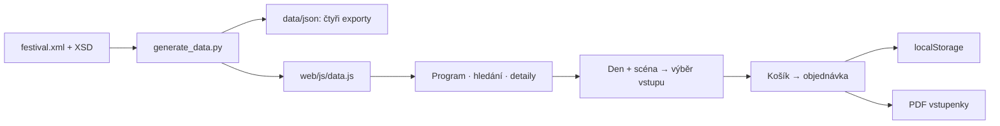

# Jak projekt funguje

Hotový web je ve složce **`web/`**. Po rozbalení celého projektu otevřete
`web/index.html`. Data, obrázky, písma i PDF knihovny jsou přibalené.

## Od dat k návštěvě festivalu

**XML je zdroj.** JSON exporty se odvozují ze stejného XML; samostatně se
neupravují. `data.js` nastaví `window.FESTIVAL_DATA`, ze kterého čte web.
Generátor je nástroj autora, při otevření stránky se nespouští.

### Co je v XML a JSON

| Data | Co obsahují | Kde je využíváme |
| --- | --- | --- |
| Festival | Název, termín, místo, dny, tarify, kemp | Úvod, kontakty, nákup |
| Scény | ID, název, popis, kapacita a kategorie | Přehled scén, filtr, dostupnost |
| Interpreti | ID, jméno, žánr, popis, hudební odkazy | Seznam, hledání, detail |
| Vystoupení | ID, čas, ID dne, scény a interpretů | Program, osobní výběr, předvolba vstupu |

Například vystoupení propojí `performerIds` s interpretem a `venueId` se
scénou. Detail používá skutečné datum a scénu tohoto objektu, nikoli ručně
napsaný odkaz na obecnou nabídku vstupenek.

`data/json/` obsahuje `festival.json`, `venues.json`, `performers.json`
a `events.json`. Mají stejný obsah jako webová data. Hodí se pro kontrolu,
čtení dat mimo web a další export; web z nich nemusí stahovat data přes síť.
Kořenové `data.xml` a `festival.xsd` jsou kopie pro odevzdání.

**JSON-LD** je další použití JSON: úvod vkládá strojově čitelný popis
festivalu pro vyhledávače. Není zdrojem účtů ani náhradou XML.

## Filtry a propojení

- **Den a scéna:** porovnání ID vystoupení s vybranými hodnotami.
- **Textové hledání:** odstranění rozdílů v diakritice a velikosti písmen,
  poté `includes()` nad názvem, žánrem a popisem.
- **Osobní program:** uložená ID vystoupení; časové intervaly odhalí kolize.
- **Vstupenka z detailu:** den a scéna vystoupení předvyplní nákup,
  návštěvník může rozsah změnit.
- **Kapacita:** z platných objednávek aktuálního ročníku se spočítají
  prodané vstupy pro každou scénu a den.

## Kde co najdu

| Umístění | Účel |
| --- | --- |
| `web/` | Stránky, CSS, JavaScript, obrázky a knihovny hotového webu |
| `data/` | Hlavní XML, XSD a odvozené JSON exporty |
| `prototype/` | Samostatný interaktivní wireframe pro navigaci a dva scénáře |
| `course-source/` | Zdroj snímků, poznámek a průběžných zpráv |
| `odevzdani/` | Vytvořené balíčky pro jednotlivá cvičení |
| `docs/` | Průvodce a doplňková Word/PDF dokumentace |
| `review/` | Vlastní kontroly a přijaté hodnocení druhého týmu |
| `tests/` | Automatické ověření dat, webu a školních podkladů |
| `tools/` | Generátor dat, prezentací a dokumentace |
| `preview/` | Ukázky vzhledu pro README a dokumentaci |

### Stránky webu

`index.html` představuje festival. `program.html`, `performers.html`
a `venues.html` pracují s programovými daty; jejich detaily určují parametry
adresy. `search.html` zobrazuje výsledky hledání. `tickets.html` a `cart.html`
obsluhují nákup, `account.html` profil a historii. `info.html` obsahuje
praktické informace, `news.html` články. Soukromí, podmínky a zdroje mají
vlastní stránky `privacy.html`, `terms.html` a `credits.html`.

Při otevření z disku navigace zachovává jeden vstupní soubor
(`index.html?page=…`), aby stránky sdílely místní úložiště.

### Hlavní skripty a funkce

| Skript v `web/js/` | Odpovědnost |
| --- | --- |
| `data.js` | Přibalený export XML v `FESTIVAL_DATA` |
| `app.js` | Stránky programu a interpretů, filtry, vyhledávání a košík |
| `admission.js` | Rozsahy vstupu, kategorie, ceny a kapacitní pravidla |
| `capacity.js` | Prodané a zbývající vstupy podle scény a dne |
| `account.js` | Registrace, profil, změna hesla a obnovovací kód |
| `ticket-pdf.js` | PDF stránek vstupenek a odděleného kempového poukazu |
| `venue-map.js` | Plánek, vrstvy, přiblížení a posun |
| `i18n.js`, `artist-copy.js` | Rozhraní CZ/EN a překlady textů |
| `site-shell.js`, `design.js` | Společná navigace, patička a úvod |
| `visitor-pages.js`, `news.js` | Praktický obsah, podmínky a články |
| `privacy.js` | Volba soukromí a načtení externí mapy |
| `performer-art.js` | Fotografie přiřazené k ID a jejich kredity |

Funkce `program()` a `performers()` sestaví seznamy. `artistDetail()`
propojí interpreta s jeho vystoupeními. `ticketFor()` ověří rozsah a cenu;
`renderCart()` odvodí součty z aktuálních položek. `promoTotals()` spočítá
slevu a `includedTax()` rozloží konečnou cenu na základ a zahrnutou DPH.
`PulseTickets.generate()` vytvoří PDF ze zaznamenané objednávky.

CSS určuje vzhled a rozložení. Hlavní `web/css/style.css` doplňují menší
styly pro nákup, účet a plánek. Sémantiku, metadata a pořadí skriptů drží HTML.

## Jak funguje nákup

1. Zvolí se jedna nebo všechny scény a jeden, dva vybrané či tři dny.
2. Main Hall nabízí VIP/Regular sedadla a stání; River a Club pouze stání.
3. Kliknutí na sedadlo změní výběr i počet osob. U stání se zadává počet.
4. Souhrn i košík počítají cenu z aktuálních položek, včetně promo kódu.
5. Před dokončením se znovu ověří ceny, místa a dotčené kapacity.
6. Objednávka uchová kontakt, čas, položky, slevu a konečnou cenu pro PDF.

Společný vstup zabírá kapacitu každé scény ve všech svých dnech. Samostatný
vstup jen vybrané scény. Sedadla v Main Hall sdílí oba druhy vstupenek;
stejné místo tedy nelze prodat dvakrát. Košík není dokončený prodej.

Vstupenka ukládá `venueId`, `scope`, `days`, kategorii, místo a cenu.
`venueId` je rozsah scén, `scope` doba platnosti. Starší záznam bez `venueId`
znamená všechny scény. Objednávky starších ročníků zůstávají v historii,
ale neodečítají kapacitu aktuálního festivalu.

## Ukládání, cookies a účet

**`localStorage`** uchová data i po zavření prohlížeče; **`sessionStorage`**
platí pro relaci aktuální karty. Nejde o automaticky zapisovaný soubor
v repozitáři. Jiný prohlížeč nebo zařízení tento stav automaticky nesdílí.

| Klíč | Uložený obsah |
| --- | --- |
| `pulse:users` | Profily, datum registrace, sůl a hash hesla, hash obnovovacího kódu |
| `pulse:auth` | Přihlášený profil a vypršení po 7 dnech |
| `pulse:cart:…` | Vstupenky hosta nebo přihlášeného profilu |
| `pulse:orders` | Dokončené objednávky a jejich finanční údaje |
| `pulse:promo:cart:…`, `pulse:camping:cart:…` | Rozpracované doplňky košíku |
| `pulse:favorites` | ID uložených vystoupení |
| `prf:language`, `pulse:privacy` | Jazyk a volba externí mapy; souhlas platí 180 dnů |
| `pulse:session`, `pulse:last-order` | Relace karty a poslední objednávka hosta v `sessionStorage` |

Web sám nenastavuje HTTP cookies ani serverovou session. Lišta soukromí
ovládá nezbytné ukládání a volitelné Google Maps. Google iframe se vloží
až po souhlasu a může používat vlastní úložiště; vlastní plánek funguje bez něj.

Heslo se ukládá jako PBKDF2/SHA-256 hash s náhodnou solí a 120 000 iteracemi.
Změna vyžaduje současné heslo. Obnova vyžaduje e-mail a uložený náhodný
obnovovací kód; samotný e-mail nestačí. Kód se zobrazí při vytvoření, jeho
hash se uloží do profilu. Obnovení vymění heslo i kód.

Jde o místní klientský model. Uživatel může vlastní úložiště změnit nebo smazat;
nenahrazuje to serverové ověření identity, sdílený prodej ani ověřovací e-mail.

## Proč ponechat `vendor/` a licence

`web/vendor/` obsahuje **jsPDF**, generátor QR a vložená písma pro PDF.
Díky nim lze stáhnout vstupenku bez připojení k externím knihovnám.
Smazáním těchto souborů by export přestal fungovat.

Licenční soubory zůstávají s převzatými knihovnami a fonty. Přesný seznam
uvádí `web/vendor/README.md`; webová písma mají licence v `web/images/fonts/`.
Autory a licence fotografií evidují `web/images/PHOTO-CREDITS.md`,
`photo-credits.json` a stránka Kredity. Dvě fotografie CC BY-NC-SA jsou
omezené na nekomerční použití podle své licence.

## K čemu je `review/`

- **`internal-review.md`:** vlastní ověření rozhraní a scénářů.
- **`received-review.md`:** připomínky přijaté od jiného týmu.
- **Validační JSON záznamy:** rozsah a výsledek konkrétního technického běhu.

Školní zadání vyžaduje cross-review. Proto se přijatý posudek uchovává
odděleně od vlastních testů; bez dodaného cizího projektu se nálezy nevymýšlejí.

Podrobné postupy úprav a testů jsou v [DEVELOPMENT.md](DEVELOPMENT.md).

## Čtení Markdownu ve VS Code

`Ctrl+Shift+V` otevře náhled dokumentu; `Ctrl+K`, potom `V` náhled vedle
zdroje. Tabulky, odkazy a diagramy se zobrazují v náhledu. Zápis s `#` a `|`
je zdrojový Markdown.
