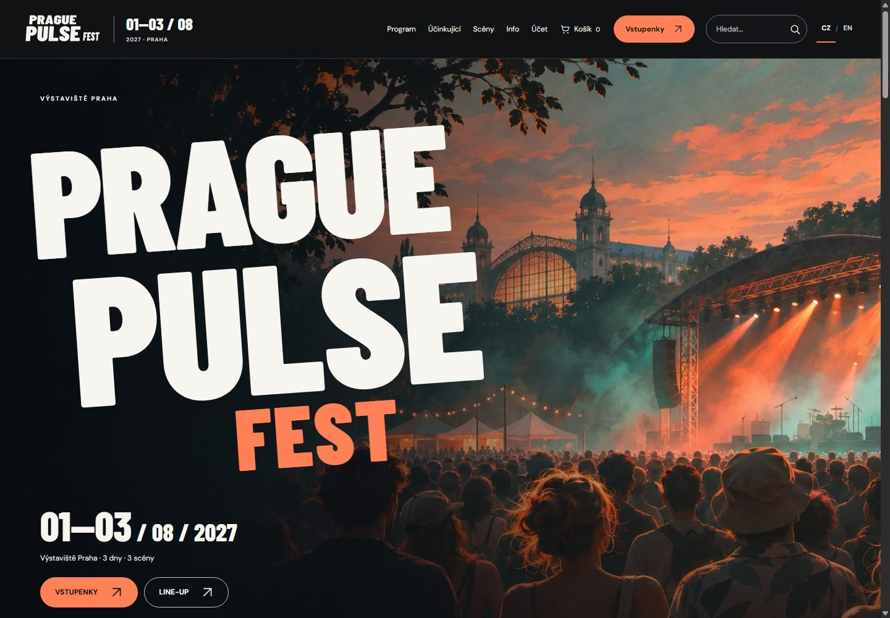

# Česká zemědělská univerzita v Praze

**Provozně ekonomická fakulta**  
**Katedra informačních technologií**


# Prague Pulse Fest

Dokumentace projektu z předmětu **Webdesign** · akademický rok **2026/2027**  
**Michal Ladra · Matěj Mlejnek · Jan Martínek**  
Festival: **1.–3. srpna 2027 · Výstaviště Praha**  
Aktualizováno: **10. listopadu 2026**

## 1. Co projekt řeší

Prague Pulse Fest je fiktivní městský hudební festival. Web návštěvníkovi umožňuje najít koncert, sestavit osobní program, zorientovat se v areálu a projít ukázkovým nákupem vstupenek. Obsahuje 60 účinkujících a 60 vystoupení ve třech dnech na třech scénách. Účast uvedených interpretů je fiktivní; projekt neoznamuje skutečný festival ani spolupráci s Výstavištěm.

Web používá HTML, CSS a JavaScript. Odevzdaná složka `web/` funguje přímo po otevření `index.html`, bez Node.js, instalace balíčků, buildu, databáze nebo backendu. Účty, objednávky a kapacity existují pouze v místním úložišti konkrétního prohlížeče. Platba je simulovaná a e-maily se neposílají.



## 2. Spuštění a struktura

Rozbalte celý projekt a otevřete `web/index.html` v aktuálním Chrome, Edge nebo Firefoxu s povoleným JavaScriptem a místním úložištěm. Pro běžné použití nic neinstalujte. Veřejná verze používá stejné statické soubory jako odevzdání; hosting nemění způsob výpočtů ani ukládání dat. Lokální a hostovaná verze mají oddělené úložiště.

```text
projekt/
├── project-specification.md  identita, architektura, uživatelé a scénáře
├── prototype/                původní interaktivní návrh
├── documentation.md          tento hlavní dokument
├── data.xml                  datová základna k odevzdání
├── festival.xsd              schéma XML
├── web/                      samostatně spustitelný web
│   ├── index.html            úvod
│   ├── performer.html        samostatný profil podle parametru id
│   ├── css/                  vzhled a responzivní rozložení
│   ├── js/                   data, logika a vykreslování
│   ├── images/               AI ilustrace, SVG a lokální písma
│   └── vendor/               jsPDF, QRCode, fonty PDF a licence
└── review/
    └── received-review.md    místo pro skutečné hodnocení jiného týmu
```

Repozitář dále obsahuje `data/`, `docs/`, `tests/` a `tools/` pro údržbu a ověřování. Tyto složky nejsou závislostí běžícího webu. Samostatné balíčky k odevzdání obsahují jen podklady potřebné pro dané cvičení; neduplikují celý vývojový repozitář.

## 3. Stránky a navigace

| Stránka | Účel a hlavní vazby |
| --- | --- |
| `index.html` | Představení, datum, line-up, vstupenky a novinky |
| `program.html` | Program s filtry dne, scény, žánru, textu a uložených koncertů |
| `performers.html` | Přehled 60 jmen, hledání a filtr žánru |
| `performer.html?id=i8` | Samostatná stránka DARKZY, medailonek, hudební odkazy, koncert a odpovídající vstup |
| `venues.html` | Scény, jejich kapacity a odkazy na filtrovaný program |
| `info.html` | Doprava, plánek areálu, FAQ, přístupnost a kontakty |
| `search.html?q=DARK` | Skutečné výsledky hledání napříč daty a informacemi |
| `tickets.html` | Den, rozsah scén, kategorie, sedadla nebo počet stojících osob |
| `cart.html` | Kontakty, slevový kód, kemp, platební simulace a potvrzení |
| `account.html` | Lokální registrace, přihlášení, profil, obnova přístupu a historie |
| `news.html` | Přehled a detail tří redakčních článků |
| `privacy.html` | Úložiště, externí mapa a nastavení soukromí |
| `terms.html` | Srozumitelné podmínky fiktivní nabídky |
| `credits.html` | Původ AI grafiky, písma a licence knihoven |

Hlavička a patička jsou společné. Vyhledávání je viditelné v hlavičce na desktopu i mobilu; po odeslání vede na samostatnou stránku výsledků. Aktivní sekce má `aria-current`. Drobečková navigace používá element `nav` s popiskem. Na mobilu se hlavní navigace rozbalí tlačítkem s `aria-expanded`.

Profil interpreta má vlastní URL, `h1`, titulek a popis. Odkazy jsou skutečné elementy `a`, proto fungují i otevření v nové kartě a tlačítko Zpět. Kontextový detail koncertu zůstává dialogem; požadavek učitele na samostatnou stránku se týká interpreta.

Při `file://` se interní cesty převádějí na `index.html?page=…`. Všechny pohledy tak sdílejí tentýž souborový původ a úložiště. Na hostingu se používají běžné adresy jednotlivých HTML stránek. Sdílené funkce `routeUrl()` zachovávají parametry dne, scény a interpreta.

## 4. Datový model XML a JSON

Hlavním zdrojem je `data/festival.xml` a jeho schéma `data/festival.xsd`. Kořenové `data.xml` a `festival.xsd` jsou přesné kopie určené pro odevzdání. Generátor `tools/generate_data.py` vytváří čtyři čitelné JSON exporty a `web/js/data.js`.

```text
data/festival.xml + data/festival.xsd
        │ volitelný autorský export
        ├── data/json/festival.json
        ├── data/json/venues.json
        ├── data/json/performers.json
        ├── data/json/events.json
        └── web/js/data.js → window.FESTIVAL_DATA
```

V prohlížeči se XML ani JSON nenačítají pomocí `fetch()`. Soubor `data.js` nastaví datový objekt před spuštěním aplikace. Proto funguje i přímé otevření z disku. Exporty se ručně neupravují; změna programu začíná v XML.

| Entita XML | Obsah | Objekt JavaScriptu |
| --- | --- | --- |
| `festival` | Název, termín, místo, kontakt, ceníky, kemp a modelová DPH | `FESTIVAL_DATA.festival` |
| `haly/hala` | Stabilní ID scény, kapacita, popis, ceny a fyzická místa | `FESTIVAL_DATA.venues` |
| `interpreti/interpret` | ID, jméno, žánr, typ, medailonek a hudební odkazy | `FESTIVAL_DATA.performers` |
| `sumakce/akce` | ID, čas, den, scéna a odkazy na interprety | `FESTIVAL_DATA.events` |

Reference `den_ref`, `hala_ref` a `interpret_ref` ukazují na konkrétní existující ID. Web zachovává tato ID ve filtrech, URL, osobním programu i vstupence. Zobrazované texty se mohou překládat, hodnoty ID a položek formulářů zůstávají stejné.

Na každé scéně je 20 vystoupení a za každý den celkem 20. Běžný set trvá 60 minut, hlavní večerní koncert v Main Hall 90 minut; přestavba na stejné scéně trvá nejméně 30 minut. Scény mohou hrát současně. Závěrečné sety River 18:30–19:30, Club 20:00–21:00 a Main Hall 21:30–23:00 navazují s časem na přesun. Aplikace netvrdí, že lze absolvovat všech 60 celých koncertů.

## 5. Architektura JavaScriptu

Jednotlivé soubory uzavírají interní stav do funkcí a zveřejňují malé objektové rozhraní v `window`. Sdílené datové výpočty tak nejsou rozkopírované po stránkách. `Object.freeze()` chrání veřejná rozhraní před nechtěnou změnou; pole obsahu se filtrují a řadí bez přepisování kanonických dat.

| Modul | Odpovědnost a podstatné funkce |
| --- | --- |
| `data.js` | Automaticky odvozený katalog `FESTIVAL_DATA` |
| `admission.js` | `PulseAdmission`: kanonické ceny, dny, kategorie, fyzická místa, `ticketFor`, `validTicket`, `available`, `remaining`, `committed` |
| `capacity.js` | `PulseCapacity.snapshot`, `html`, `mount`: stejné objednávky a kapacity pro přehledy i plánek |
| `app.js` | Směrování stránek, filtry, vlastní program, detaily koncertů, výběr vstupenek a dokončení objednávky |
| `site-shell.js` | Sdílená hlavička, navigace, patička a odpočet |
| `design.js` | Kompozice úvodní stránky a nabídky odvozené z dat |
| `i18n.js` | `PulseI18n.t`, `apply`, `setLanguage`, `missing`: překlad textů, atributů a metadat |
| `artist-copy.js` | Anglické medailonky odvozené od českého obsahu |
| `performer-art.js` | Stabilní přiřazení AI hudebních motivů k ID; nejde o portréty interpretů |
| `venue-map.js` | Vlastní SVG plánek, den, přiblížení, posun a odkazy na program |
| `visitor-pages.js` | Praktické informace, FAQ, podmínky, soukromí a kredity |
| `news.js` | České a anglické články a jejich detail |
| `privacy.js` | Souhlas s externí mapou a správa lokálních preferencí |
| `account.js` | Registrace, přihlášení, kontakt, heslo a kód obnovení |
| `ticket-pdf.js` | Lokální načtení knihoven, rozdělení slevy, generování a stažení PDF |

Použití objektů zde slouží sdílení odpovědnosti a ověřitelných pravidel. Přepis veškerého kódu do dědičnosti nebo frameworku by nepřinesl návštěvníkovi přínos a krátce před odevzdáním by zvýšil riziko regrese. Projekt proto zachovává jednoduché moduly bez bundleru.

## 6. Program, hledání a osobní seznam

Program lze kombinovaně filtrovat podle dne, scény, přesného žánru, textu a vlastních uložených koncertů. Žánr je společný s filtrem interpretů. Hledání převádí text do normalizace NFD, odstraní diakritiku a sjednotí velikost písmen. Porovnává podřetězec v datech včetně medailonků a přeloženého obsahu. Prázdné výsledky mají srozumitelný stav a filtry lze vymazat.

Uložení používá stabilní ID koncertu v `pulse:favorites`. Seznam přetrvá po otevření stránky. Dvojice uložených setů ve stejný den se porovnají podle intervalu začátku a konce; skutečný překryv vyvolá textové upozornění. Navazující koncerty s totožným koncem a začátkem nejsou kolize. Upozornění doplňuje běžný seznam a nic automaticky neodstraňuje.

Na stránce výsledků vedou odkazy na konkrétního interpreta, koncert, scénu nebo část praktických informací. Není použitá statická ukázka předem zadaného slova. Uživatelský vstup se při vykreslení escapuje; vyhledávací text se nevkládá jako HTML.

## 7. Vstupenky, cena a kapacity

Návštěvník volí jednu scénu nebo všechny, jeden až tři dny a kategorii. Dvoudenní vstup vyžaduje dvě různé výslovně vybrané hodnoty. U sedadel se počet odvozuje z vybraných míst, u stání se zadává počet osob. Najednou lze přidat nejvýše osm osob; celá objednávka má limit 264 vstupenek.

| Scéna | Kapacita na den | Rozdělení |
| --- | --- | --- |
| Main Hall | 5 000 | 16 VIP, 32 Regular, 4 952 stání |
| River Stage | 3 000 | Stání |
| Club Stage | 1 500 | Stání |

Jde o návrhové kapacity fiktivního festivalu. Dostupnost je počet prodaných vstupů na scénu a den, nikoli živé měření osob před pódiem. Společný vstup blokuje jednu osobu na každé scéně pro každý zvolený den. Samostatný vstup blokuje pouze danou scénu. Společná a samostatná varianta sdílejí fyzická sedadla Main Hall. Označení stání je interní reference položky, nikoli rezervovaný bod na ploše.

Plánek čerpá ze stejného `PulseCapacity.snapshot()` jako nákup. Přepínač dne mění dostupnost a odkazy na program. Objednávky stejného ročníku jsou načtené z `pulse:orders`; starší ročníky neblokují aktuální místa. Košík nevytváří dokončenou rezervaci, ale ovlivňuje další výběr v témže prohlížeči. Před dokončením se dostupnost znovu kontroluje. Událost `storage` obnovuje stav dalších karet stejného původu; `navigator.locks`, kde je dostupné, řadí zápisy objednávek.

Kapacitní tabulky byly odstraněny z každé řádky programu. Zůstávají tam, kde pomáhají rozhodnutí: detail koncertu či interpreta, scény, plánek a nákup. Tím se omezilo opakování stejné informace u desítek setů.

| Rozsah | Kategorie | 1 den | 2 dny | 3 dny |
| --- | --- | --- | --- | --- |
| Všechny scény | VIP | 590 Kč | 1 180 Kč | 1 590 Kč |
| Všechny scény | Regular | 390 Kč | 780 Kč | 990 Kč |
| Všechny scény | Stání | 190 Kč | 380 Kč | 490 Kč |
| Main Hall | VIP | 490 Kč | 980 Kč | 1 290 Kč |
| Main Hall | Regular | 290 Kč | 580 Kč | 790 Kč |
| Main Hall | Stání | 150 Kč | 300 Kč | 390 Kč |
| River Stage | Stání | 110 Kč | 220 Kč | 290 Kč |
| Club Stage | Stání | 90 Kč | 180 Kč | 240 Kč |

Kemp je jedno místo na objednávku: stan 350 Kč pro nejvýše čtyři osoby nebo karavan 850 Kč pro nejvýše šest osob, vždy plus 150 Kč za osobu. Nabídka má 40 stanových a 12 karavanových míst. Pobyt je na tři noci 1.–4. srpna 2027. `PULSE10` snižuje cenu vstupenek o 10 %, `PRAHA200` nejvýše o 200 Kč. Kódy se nesčítají a nezlevňují kemp.

Ceny už zahrnují modelovou 12% DPH a nulový objednávkový poplatek. Daň se znovu nepřičítá. Příklad původního prezentačního scénáře: dvě VIP vstupenky na dva dny a všechny scény, PULSE10 a stan pro dvě osoby: **2 × 1 180 − 236 + 350 + 2 × 150 = 2 774 Kč**. Jde o model cen školního projektu, nikoli daňové doporučení.

## 8. Objednávka a PDF

Host vyplní jméno, příjmení, e-mail a telefon. Účet není povinný. Formulář ověřuje požadované hodnoty, formát e-mailu, počet číslic telefonu a souhlas s podmínkami školní ukázky. Simulace zamítnuté platby nevytvoří objednávku; úspěšný stav uloží úplný objekt objednávky a vyprázdní košík. Není připojena skutečná platební brána.

`PulseTickets.generate(order)` vrací `Blob` PDF; `download(order)` vytvoří dočasnou adresu přes `URL.createObjectURL`, nabídne soubor ke stažení a adresu následně uvolní. jsPDF, QRCode a české fonty se načtou až při exportu ze složky `vendor/`, bez CDN a bez síťového API.

Každá vstupenka má vlastní stránku s objednávkou, kupujícím, ročníkem, přesnými dny, scénou, kategorií, sedadlem nebo stáním a QR identifikátorem. Kemp má samostatný poukaz. Sleva se rozděluje mezi lístky v celých haléřích poměrem ceny metodou největšího zbytku, aby součet odpovídal objednávce. Z ceny po slevě se dopočítává základ a zahrnutá daň.

QR obsahuje identifikátor, ale neověřuje se na serveru. PDF je školní ukázka a neopravňuje ke skutečnému vstupu. Údaje v něm vznikají z uložené objednávky, nikoli z později změněného profilu. Při chybě načtení knihovny se zobrazí hláška a tlačítko se odblokuje.

## 9. Účet, úložiště a soukromí

| Klíč nebo skupina | Obsah |
| --- | --- |
| `pulse:users` | Lokální profily, sůl a hash hesla |
| `pulse:auth` | ID přihlášeného uživatele a konec sedmidenní platnosti |
| `pulse:cart:guest`, `pulse:cart:<id>` | Oddělené košíky hosta a účtu |
| `pulse:orders` | Dokončené místní objednávky a podklad kapacit |
| `pulse:favorites` | ID uložených koncertů |
| `pulse:promo:*`, `pulse:camping:*` | Rozpracované doplňky košíku |
| `pulse:privacy` | Rozhodnutí o externích mapách, verze a datum |
| `prf:language` | Jazyk cs nebo en |

Data se čtou s kontrolou tvaru a při chybném JSON se používá bezpečný výchozí stav. Nejde o serverovou autentizaci: místní data může vlastník zařízení změnit nebo smazat. Pro školní demo nepoužívejte skutečné heslo k jiné službě.

V podporovaném bezpečném kontextu se heslo odvozuje pomocí PBKDF2-SHA256 se 120 000 iteracemi a náhodnou solí. Kód obsahuje i kompatibilní cestu pro prostředí bez Web Crypto; tyto varianty nepovažujeme za produkční zabezpečení. Registrace vygeneruje jednorázově zobrazený kód pro obnovu, jehož verifier se ukládá odděleně. Obnova vyžaduje e-mail a uložený kód; neposílá zprávu e-mailem.

Při přihlášení se slučuje košík hosta s účtem a znovu ověřuje duplicita sedadel. Změna hesla vyžaduje dosavadní heslo a zruší platné přihlášení. Historie patří lokálnímu uživateli. Smazání dat prohlížeče odstraní i účty a objednávky. Přenos JSON zálohou nepředstavuje sdílený inventář mezi zařízeními.

Web nepoužívá analytické ani reklamní cookies. Externí Google Maps se načtou pouze po souhlasu. Vlastní SVG plánek zůstává použitelný offline a bez tohoto souhlasu. Lokální písma, ilustrace, data a knihovny nejsou závislé na externím CDN.

## 10. Čeština a angličtina

Překlad používá slovník úplných textů, vzory pro číselné hlášky a slovní náhrady pro složené popisky. `MutationObserver` překládá nově vykreslený obsah a přístupné atributy. `Intl` formátuje datum a měnu podle zvoleného jazyka. Jména, ID, kontakty, zadané hodnoty a obsah označený `data-no-translate` se nepřekládají.

Oprava z 10. listopadu nahrazuje kaskádu postupných slovních záměn jediným průchodem regulárního výrazu. Už přeložené anglické slovo se proto znovu nemění v dalším kroku. Používá se britská podoba **Programme**, která je správná; chybná podoba s opakovaným „m“ se nesmí objevit. `PulseI18n.missing()` pomáhá zachytit nepřeložené české texty, ale nenahrazuje jazykovou kontrolu a neodhalí všechny věty bez diakritiky.

## 11. UX, přístupnost a aktuální doporučení

Rešerše byla aktualizována 10. listopadu 2026 podle primárních zdrojů. Rozhodnutí jsou konkrétní pro tento web:

| Doporučení a zdroj | Implementace |
| --- | --- |
| [WAI: struktura stránky](https://www.w3.org/WAI/tutorials/page-structure/) | Oblasti header/nav/main/footer, h1 a hierarchie nadpisů, skip link, popisky formulářů |
| [WCAG 2.2 a nové požadavky](https://www.w3.org/WAI/standards-guidelines/wcag/new-in-22/) | Viditelný focus, dostupná tlačítka, ovládání bez tažení pomocí tlačítek a kláves u mapy |
| [WAI: velikost cíle](https://www.w3.org/WAI/WCAG22/Understanding/target-size-minimum.html) | Hlavní dotyková tlačítka zpravidla alespoň 44 px; interaktivní místa mapy mají textové alternativy |
| Mobile-first a postupné zjednodušování | Pružné sloupce Grid/Flexbox, clamp, minmax, mobilní navigace a méně opakovaných kapacit |
| Kontext a prevence chyb | Předvolba vstupu z koncertu, povinné dva dny, průběžná cena, kontrola dostupnosti před dokončením |
| Omezení pohybu | `prefers-reduced-motion` potlačuje zbytečné animace |

Obsazenost a chyby mají textový význam, nikoli jen barvu. Výsledky filtrů používají stavové oblasti. Tabulky slouží cenám a skutečným tabulkovým údajům; k rozložení webu se nepoužívají. Obrázky mají rozměry a popisky, dekorativní ilustrace jsou skryté před čtečkou. Odkazy na hudební platformy jsou označené jako externí.

Provedené kontroly nejsou úplný audit WCAG 2.0 AA nebo 2.2. Zvlášť je potřeba lidská kontrola se čtečkou obrazovky a validátorem HTML Living Standard. Dokumentace netvrdí certifikovanou shodu.

## 12. SEO, AEO, GEO a AI agenti

[Google AI features and your website](https://developers.google.com/search/docs/appearance/ai-features) uvádí, že pro AI funkce zůstávají relevantní běžné základy SEO. Neexistuje povinné zvláštní AI schema. Proto projekt nepřidává smyšlená hodnocení, falešnou autoritu nebo sliby zařazení do AI odpovědí.

Každá relevantní HTML stránka má konkrétní title, description, viewport a jazyk, dále favicon a Open Graph. Profil interpreta aktualizuje metadata podle jména. Strukturovaná data Festival na úvodu odpovídají viditelnému názvu, datu a místu; jejich obsah se odvozuje od stejného datového modelu.

Podle [Google JavaScript SEO basics](https://developers.google.com/search/docs/crawling-indexing/javascript/javascript-seo-basics) nemusí všichni roboti spouštět JavaScript. Proto se do 13 hlavních HTML vstupů ukládá i výchozí obsah, navigace a odkazy. Prohlížeč je při spuštění obnoví z týchž dat; nejde o samostatnou druhou obsahovou databázi. Volitelný autorský nástroj `prepare-static.cjs` snapshot obnoví po změně dat. Pro spuštění odevzdaného webu se tento krok nevyžaduje.

Čitelné odkazy propojují stránky, FAQ odpovídá přímo na návštěvnické otázky a stabilní ID umožňují adresovat konkrétní obsah. Titulek a přístupné názvy pomáhají také agentům rozpoznat funkci ovládání. Parametrické detaily interpretů a výsledky hledání nadále vyžadují pro plný obsah JavaScript. Jazyková preference je lokální, nikoli dvě samostatně indexovatelné jazykové verze; neuvádíme zavádějící hreflang. Indexaci, pozici ve vyhledávání ani citaci AI službou jsme neměřili.

## 13. Grafika a zdroje

Na přání týmu byly reálné fotografie nahrazeny původní AI grafikou podle zadání. Dva nové bitmapové podklady vytvořil OpenAI Image Generation dne 10. listopadu 2026. `festival-hero-ai.webp` zobrazuje výtvarnou představu festivalového večera. `music-artwork-ai.webp` obsahuje mřížku 4 × 4 hudebních motivů. CSS vybírá buňku podle ID interpreta; motivy se u 60 jmen opakují a nevydávají se za jejich portréty.

Výstupy byly prohlédnuty a převedeny do WebP: přibližně 157 kB a 494 kB místo několika MB PNG. Logo festivalu, ikony, novinkové ilustrace a plánek jsou původní SVG/CSS vytvořené s AI. Převzaté fotografie a nevyužívaná videa se do nové složky web nepřibalují. Institucionální logo na titulní straně této dokumentace je zachováno z dodané školní předlohy na výslovné přání autora; není prezentované jako AI tvorba.

Písma Barlow Condensed a DM Sans jsou lokální, včetně české znakové sady a licencí SIL OFL. PDF používá přibalené licencované fonty. Přehled knihoven a licencí je v `web/vendor/README.md`, promptů a obrázků v `web/images/ASSETS.md`.

## 14. Vývoj a zdůvodnění změn

| Podnět nebo fáze | Změna | Důvod a způsob ověření |
| --- | --- | --- |
| Specifikace a prototyp | Zachována identita, tři scénáře, datové entity a rozsah | Porovnání dodaného prototypu a vazeb XML |
| Implementace | Propojení programu, interpretů, vstupenek, účtu a PDF | Praktické scénáře S1–S3 |
| Připomínka učitele ke cvičení 3 | Detail interpreta převeden z dialogu na samostatnou stránku | Přímá URL, titulek, návrat zpět a propojení s koncertem |
| Připomínka učitele k hledání | Pole v hlavičce na desktopu i mobilu, samostatné výsledky | Vyhledání DARK a přechod na odpovídajícího interpreta |
| Kontrola před cvičením 4 | Překlad jedním průchodem, nový filtr žánru a méně kapacitních panelů | Kontrola CZ/EN a kombinace filtrů |
| Úplné zadání od týmu | AI ilustrace místo skutečných fotografií | Vizuální kontrola, původ, velikost a kredity |
| Příprava podkladů | Aktuální README, dokumentace, zprávy a balíčky | Kontrola povinné struktury a odkazů |

Aktuální úpravy zachovávají program, data, cílové skupiny i hlavní scénáře. Nepředstavují změnu tématu festivalu. Přesný rozsah změn vůči prvním dvěma schváleným výstupům musí tým doložit původními verzemi; dokumentace bez těchto podkladů nepotvrzuje splnění limitu přibližně 15 %.

## 15. Cross-review a práce po cvičení 6

Skutečné cross-review jiného týmu zatím nebylo dodáno. K 10. listopadu 2026 proto nelze popsat zapracované změny po cvičení 6. `review/received-review.md` je připravené místo pro přijaté hodnocení a jeho vypořádání.

| Připomínka | Závažnost | Rozhodnutí | Provedená změna / zdůvodnění odmítnutí |
| --- | --- | --- | --- |
| Čeká se na skutečný posudek jiného týmu | Neurčena | Doplnit po přijetí | Zatím se žádné vypořádání netvrdí |

Pro hodnocení cizího projektu je zvlášť připravena šablona `review/review-template.md` se dvěma metodami: Nielsenovou heuristickou evaluací a kognitivním průchodem nejméně dvou scénářů. Každý nález má mít závažnost, postup reprodukce, zdůvodnění a návrh opravy. Technické testy našeho webu nepředstírají externí review.

## 16. Postup práce a týmová spolupráce

Projekt navazuje na předanou specifikaci, XML a prototyp ze cvičení 3. Následovalo propojení stránek, sjednocení cen a dostupnosti, lokální účet a PDF, kontrola mobilního rozhraní a překladů. Před cvičením 4 se řešily konkrétní připomínky učitele a prováděly nové testy skutečného rozhraní. Repo obsahuje vývojové nástroje, hotový web je na nich nezávislý.

Autoři projektu jsou Michal Ladra, Matěj Mlejnek a Jan Martínek. Podrobný historický rozpis práce jednotlivých členů nebyl v podkladech doložen, proto zde není vymyšlen. Při týmové práci se mají změny dat provádět v XML, změny vzhledu v CSS a sdílená nákupní pravidla v admission.js. Před společným odevzdáním tým projde stejné scénáře z projektové specifikace a kontroluje aktuální commit, aby všichni předváděli totožnou verzi.

Použité prostředky: HTML Living Standard, CSS Grid/Flexbox, standardní DOM a Web APIs, localStorage/sessionStorage, Web Crypto, SVG, JSON, XML/XSD, jsPDF a QRCode. K údržbě slouží GitHub, volitelné Python skripty, Node.js při automatizovaném ověřování a Chrome při průchodech. Testovací statický HTTP server je pomůcka testů, nikoli backend webu.

## 17. AI a kontrola výstupů

V dodaných podkladech je uvedena pomoc Claude s prezentacemi. V této revizi pomohl OpenAI Codex s auditem, opravami JavaScriptu, podklady k odevzdání a testy; OpenAI Image Generation vytvořil dvě nové ilustrace. Přesné historické verze modelů a autorství každé starší věty nejsou doložené.

| Příklad zadání AI | Přijatý výstup a vlastní kontrola |
| --- | --- |
| Oprav opakované překládání názvu programu a zachovej ID | Úprava překladového průchodu; kontrola všech 14 stránek v CZ/EN |
| Přenes detail interpreta na samostatnou stránku | URL a interní odkazy; průchod DARK → profil → správná vstupenka |
| Vytvoř původní večerní festivalovou ilustraci bez textu | Vizuální kontrola kompozice a označení, že jde o fiktivní scénu |
| Vytvoř mřížku šestnácti hudebních motivů bez portrétů | Kontrola mřížky a stabilního přiřazení; odmítnuto vydávání obecných tváří za reálné interprety |
| Ověř kapacitu při nákupu vstupu na jeden a tři dny | Skutečně vytvořené lokální objednávky; porovnání plánu, nákupu a dnů |

AI výstupy nebyly přijaty jako důkaz správnosti. Přijaty byly konkrétní opravy po testu, upraveny překlady a texty zdrojů, odstraněny zastaralé fotografie a opakované kapacitní karty. Odmítnuto je tvrzení o proběhlém externím review a převzetí starého počtu 615 kontrol bez nového ověření. Výsledky nástrojů a vlastní reprodukce jsou podkladem pro tvrzení o funkčnosti.

AI pomohla zrychlit průchod rozsáhlým projektem, ale vyžadovala ověřování: původní řešení stále otevíralo interpreta dialogem, dokumentace obsahovala historické údaje a obrázky neodpovídaly úplnému zadání. Odpovědnost za obsah, prezentaci a doložení skutečné týmové práce zůstává na týmu.

## 18. Ověření a zbývající omezení

Nové výsledky jsou v `validation_report.md` a `review/technical-validation.json`. Rozsah zahrnuje 14 stránek v obou jazycích, pět šířek od 320 do 1440 px, průchody programem a hledáním, nákup, kemp, slevu, zamítnutí platby, PDF, kapacitu podle dne, účet a přímé otevření souboru. XML bylo ověřeno proti XSD; JSON a prohlížečový katalog se porovnávají s odevzdaným základem.

Nedokončené školní podklady: skutečné přijaté cross-review a jeho pozdější vypořádání, potvrzení týmové historie a úplný lidský audit přístupnosti. Technické limity: lokální účty a kapacity, simulovaná platba, neověřovaný QR, lokální jazyk bez samostatných jazykových URL. Nejde o známé blokující chyby ukázkového client-side řešení. Tyto limity musí zaznít při prezentaci a před předáním druhému týmu.
